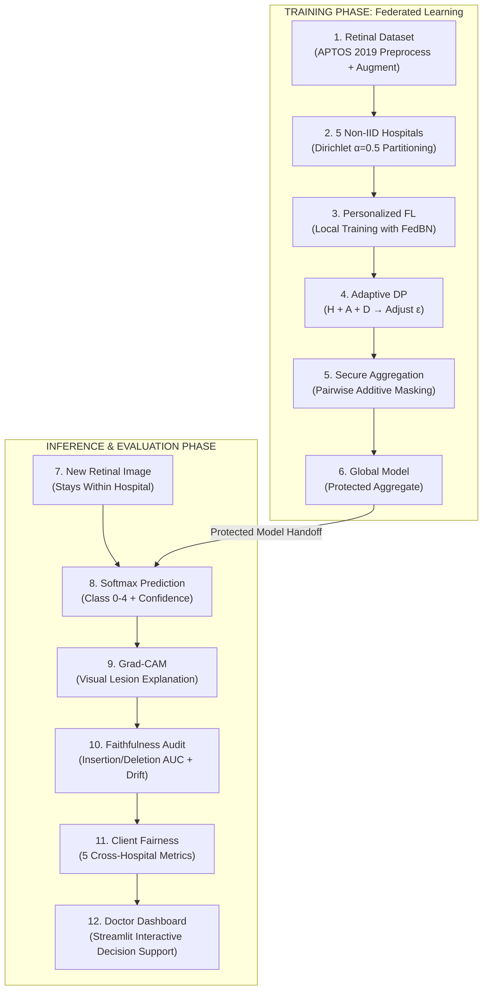

# FaithFed-XAI: An Explanation-Aware, Privacy-Adaptive Federated Learning Framework with Client Fairness Evaluation for Medical Imaging Diagnosis

**Author:** Harshni R S (RA2512044015069)  
**Program:** M.Tech in Artificial Intelligence and Data Science  
**Institution:** Department of Computational Intelligence, SRM Institute of Science and Technology, Kattankulathur  
**Supervisor:** Dr. Safa  
**Course:** 21CSC601T - Case Studies (Review 1)  

---

## 📌 Executive Summary & Research Gap
Hospitals with small or rural patient volumes cannot independently train high-performance diagnostic models, yet privacy legislation prevents pooling raw patient scans across institutions. While Federated Learning (FL) enables collaborative learning by exchanging model updates rather than patient records, it suffers from two major vulnerabilities in clinical practice:
1. **Heterogeneity & Non-IID Degradation:** Clinical sites possess divergent patient demographics, equipment, and imaging protocols.
2. **The Privacy-Explainability Trade-off:** Differential Privacy (DP-SGD) introduces stochastic noise to gradient updates to prevent model inversion; however, prior work shows that DP noise severely distorts saliency-based explanations (e.g. Grad-CAM) and disproportionately harms smaller or more diverse clinics under fixed uniform budgets.

**FaithFed-XAI** resolves these challenges jointly through:
- **FedBN Personalization:** Normalization affine parameters (`GroupNorm`) remain strictly local to each hospital, preserving domain-specific feature distributions while aggregating shared convolutional representations.
- **Explanation-Aware Adaptive Privacy Controller:** Recomputes each hospital's $(\epsilon, \delta)$ differential privacy budget dynamically based on a composite signal:
  $$S_k = w_h \cdot H_k + w_a \cdot A_k + w_e \cdot D_k$$
  *(where $H$ is data heterogeneity via Jensen-Shannon Divergence, $A$ is accuracy degradation, and $D$ is Grad-CAM explanation drift via $1 - \text{SSIM}$)*, under a fixed overall global privacy budget constraint $\frac{1}{K}\sum_k \epsilon_k = \bar{\epsilon}_{\text{target}}$.
- **Pairwise Additive Masking (Secure Aggregation):** Lightweight cryptographic masking (Bonawitz et al.) ensuring the central server never observes individual client updates.
- **Client-Level Fairness Audit:** Evaluates 5 specific cross-hospital fairness metrics to prevent under-resourced hospitals from being penalized in diagnostic accuracy or explanation faithfulness.

---

## 🏗️ System Architecture & 12-Step Lifecycle



---

## 📁 Repository Directory Structure

```text
Faithfed project/
├── app.py                         # Main Streamlit Clinical Decision Support Dashboard
├── configs/
│   └── default.yaml               # Central configuration for data, model, FL, DP, and XAI
├── data/
│   └── aptos/
│       ├── train.csv              # Labels for 3,662 fundus images (grades 0 to 4)
│       └── train_images/          # Retinal fundus photographs (.png)
├── artifacts/
│   ├── splits.json                # Non-IID 5-hospital partitions & H scores
│   ├── global_model.pth           # Aggregated global model weights
│   ├── round_log.csv              # Round-by-round federated training telemetry
│   └── hospitals/                 # Personalized local hospital weights (hospital_1..5.pth)
├── notebooks/
│   ├── 01_data_and_hospitals.ipynb
│   ├── 02_federated_training.ipynb
│   ├── 03_privacy_analysis.ipynb
│   ├── 04_gradcam.ipynb
│   ├── 05_faithfulness.ipynb
│   └── 06_fairness.ipynb
├── pages/
│   ├── 1_Diagnose.py              # Clinical inference & Grad-CAM lesion mapping
│   ├── 2_Explanation_Quality.py   # Insertion/Deletion AUC & SSIM explanation drift
│   ├── 3_Hospital_Fairness.py     # 5 cross-hospital fairness metrics audit
│   └── 4_Privacy_Budget.py        # Adaptive DP budget & pairwise secure aggregation
├── results/
│   └── evaluation_report.json     # Unbiased held-out test evaluation report
├── scripts/
│   ├── train.py                   # CLI training script
│   └── evaluate.py                # Held-out testing & benchmark script
├── src/
│   ├── __init__.py                # Package exports
│   ├── model.py                   # SmallCNN with GroupNorm (FedBN + DP-SGD)
│   ├── data_preprocessing.py      # Ben Graham illumination normalization & Dataset
│   ├── hospital_partition.py      # Dirichlet(α) non-IID splits & JS Divergence H
│   ├── fedbn.py                   # FedBN parameter separation & weighted averaging
│   ├── differential_privacy.py    # DP-SGD & Explanation-Aware Privacy Controller
│   ├── secure_aggregation.py      # Pairwise additive masking & exact cancellation audit
│   ├── gradcam.py                 # Grad-CAM heatmap extraction on Conv Block 5
│   ├── faithfulness.py            # Insertion/Deletion AUC & SSIM drift
│   ├── fairness.py                # 5 Cross-Hospital Fairness Metrics & QWK
│   └── inference.py               # RetinalDiagnosticEngine for clinical inference
├── tests/
│   └── test_secure_agg.py         # Unit tests for secure aggregation and FedBN
└── requirements.txt               # Frozen dependencies
```

---

## 🚀 Quick Start Guide

### 1. Environment Setup
The project runs with Python 3.12+ in the pre-configured virtual environment:
```powershell
.\.venv\Scripts\activate
```

### 2. Run Secure Aggregation & FedBN Unit Tests
```powershell
python -m unittest tests/test_secure_agg.py
```

### 3. Run Federated Training
To run full federated training across 5 non-IID hospitals:
```powershell
python scripts/train.py --algorithm FaithFed-XAI --rounds 5 --epochs 1 --batch_size 16
```
Available baseline algorithms: `FaithFed-XAI`, `FedBN`, `FedAvg`, `FedAvg-FixedDP`, `Centralized`.

### 4. Evaluate Held-Out Generalization & 5 Fairness Metrics
```powershell
python scripts/evaluate.py --model_path artifacts/global_model.pth
```

### 5. Launch Doctor Decision Support Dashboard
```powershell
streamlit run app.py
```
This opens the interactive multi-page web application featuring:
- **Retinal Diagnosis:** Upload fundus scans, view Ben Graham illumination correction, get predicted DR grade (0-4) with confidence, and inspect Grad-CAM lesion heatmaps.
- **Explanation Quality:** Interactive Insertion and Deletion curves with trapezoidal AUC and SSIM drift ($D$).
- **Hospital Fairness:** Demographic imbalance, Jensen-Shannon heterogeneity ($H$), and the 5 Cross-Hospital Fairness Criteria.
- **Privacy & Security:** Interactive controller weight simulation ($S = w_h H + w_a A + w_e D$) and live cryptographic mask cancellation verification.

---

## 📊 5 Cross-Hospital Fairness Metrics
1. **Performance Disparity:** $\max_k(\text{Acc}_k) - \min_k(\text{Acc}_k)$
2. **Explanation Disparity:** $\max_k(\text{Faithfulness}_k) - \min_k(\text{Faithfulness}_k)$
3. **Worst-Client Faithfulness:** $\min_k(\text{Faithfulness}_k)$
4. **Small-Client Penalty:** $\bar{F}_{\text{large}} - \bar{F}_{\text{small}}$
5. **Heterogeneity Penalty:** Pearson correlation $r(H_k, \text{Faithfulness}_k)$

---

## 🎯 UN Sustainable Development Goals (SDGs)
- **SDG 3 (Good Health and Well-Being):** Makes state-of-the-art diagnostic AI available to smaller and rural health institutions without requiring patient data transfers.
- **SDG 10 (Reduced Inequalities):** Prevents under-resourced or demographic-minority hospitals from suffering from biased models or degraded explanations under differential privacy protection.
